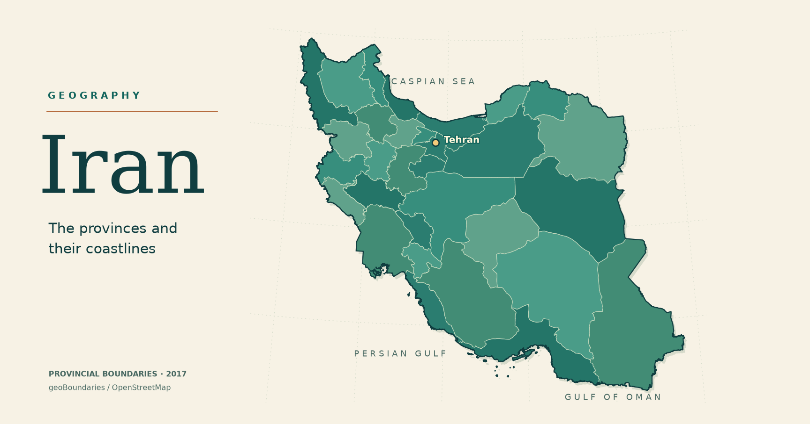

# Iran Geography



A geographic dataset of Iran’s administrative divisions and Tehran’s neighbourhoods, squares, and intersections. Records pair Persian names with Latin-script labels, often called **Finglish**.

## Data files

| File | Coverage | Records | Coordinates |
| --- | --- | ---: | --- |
| [`province.json`](province.json) | Provinces (استان) | 31 | Yes |
| [`cities.json`](cities.json) | Counties (شهرستان) | 362 | Yes |
| [`sections.json`](sections.json) | Districts (بخش) | 632 | — |
| [`towns.json`](towns.json) | Rural districts (دهستان) and towns | 3,381 | — |
| [`Tehran_Mahalat.json`](Tehran_Mahalat.json) | Tehran neighbourhood and address labels | 2,459 | 5 records |
| [`tehran_squares.json`](tehran_squares.json) | Tehran squares | 66 | Yes |
| [`tehran_intersection.json`](tehran_intersection.json) | Tehran intersections | 766 | Yes |
| [`tehran_intersection_alley_street.json`](tehran_intersection_alley_street.json) | Tehran street and alley junctions | 237 | Yes |

## Quick start

Find Abadan County in the JSON dataset with [jq](https://jqlang.org/).

```sh
jq '.[] | select(.slug == "Abadan")' cities.json
```

```json
{
  "id": 102,
  "title": "آبادان",
  "slug": "Abadan",
  "province_id": 7,
  "latitude": 30.3392,
  "longitude": 48.3043
}
```

The province and county files are top-level arrays. The other JSON files wrap their arrays under `RECORDS`. Tehran coordinates may be strings, and street and alley junctions use `location.lat` and `location.lon`.

The [MySQL export](cities.sql) recreates the `provinces`, `cities`, `sections`, and `towns` tables. Use an empty database for the import.

```sh
mysql -u YOUR_USER -p YOUR_DATABASE < cities.sql
```

## Data notes

- Province and county coordinates are representative map pins. A county pin may identify its administrative seat.
- Coverage reflects the records in this repository. Some Latin-script labels need review.
- The SQL export uses a separate set of province and county IDs. Some `sections.json` links also need reconciliation before joining them to `cities.json`.

## Sources and map credits

- Administrative divisions reference. [Statistical Centre of Iran](https://www.amar.org.ir/)
- Updated county coordinates. [GeoNames](https://www.geonames.org/export/) and [Open Admin Data](https://github.com/open-admin-data/iran-administrative-divisions), both under [CC BY 4.0](https://creativecommons.org/licenses/by/4.0/).
- The Bandar-e Gaz pin, updated Tehran junctions, and map boundary data. [© OpenStreetMap contributors](https://www.openstreetmap.org/copyright). The map uses the [2017 province boundaries from geoBoundaries](https://www.geoboundaries.org/api/current/gbOpen/IRN/ADM1/).
